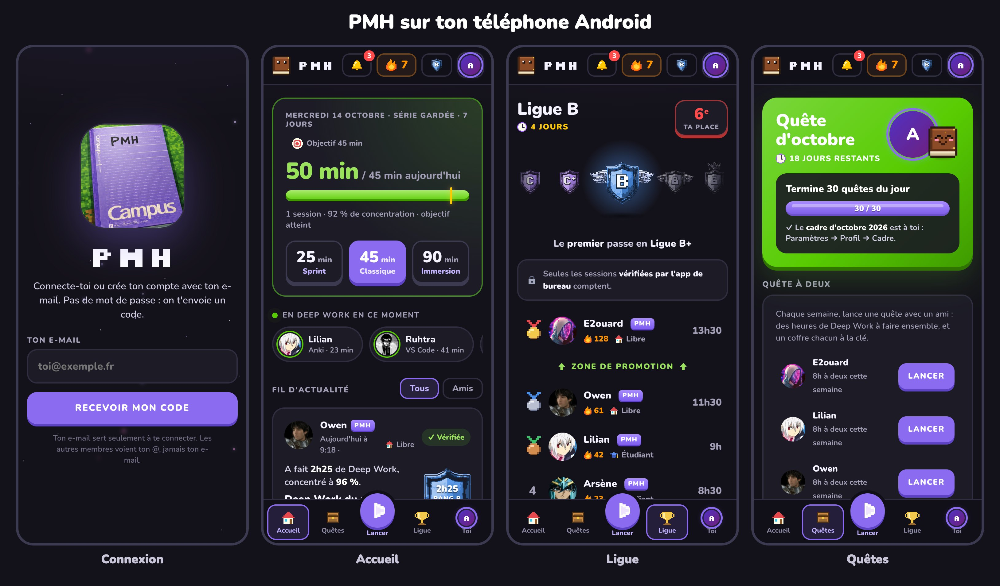
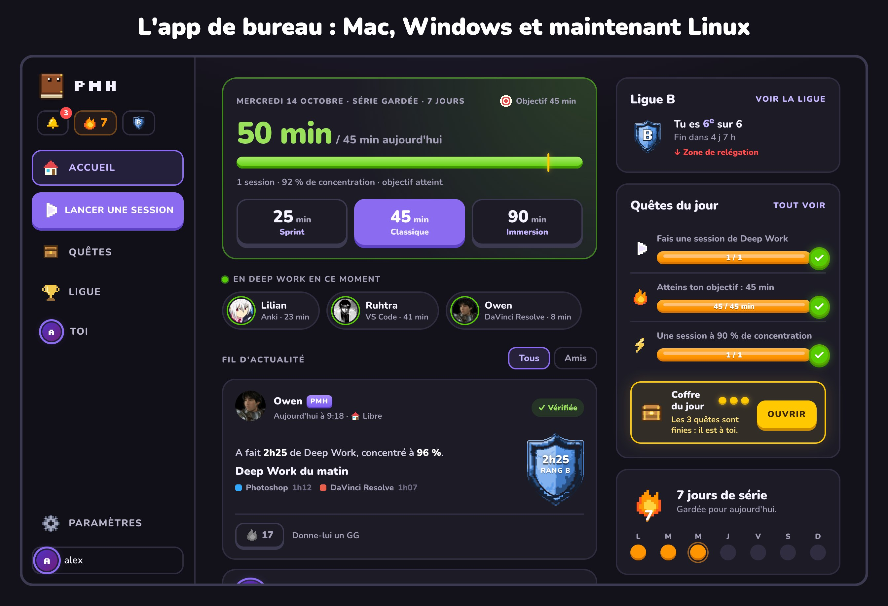
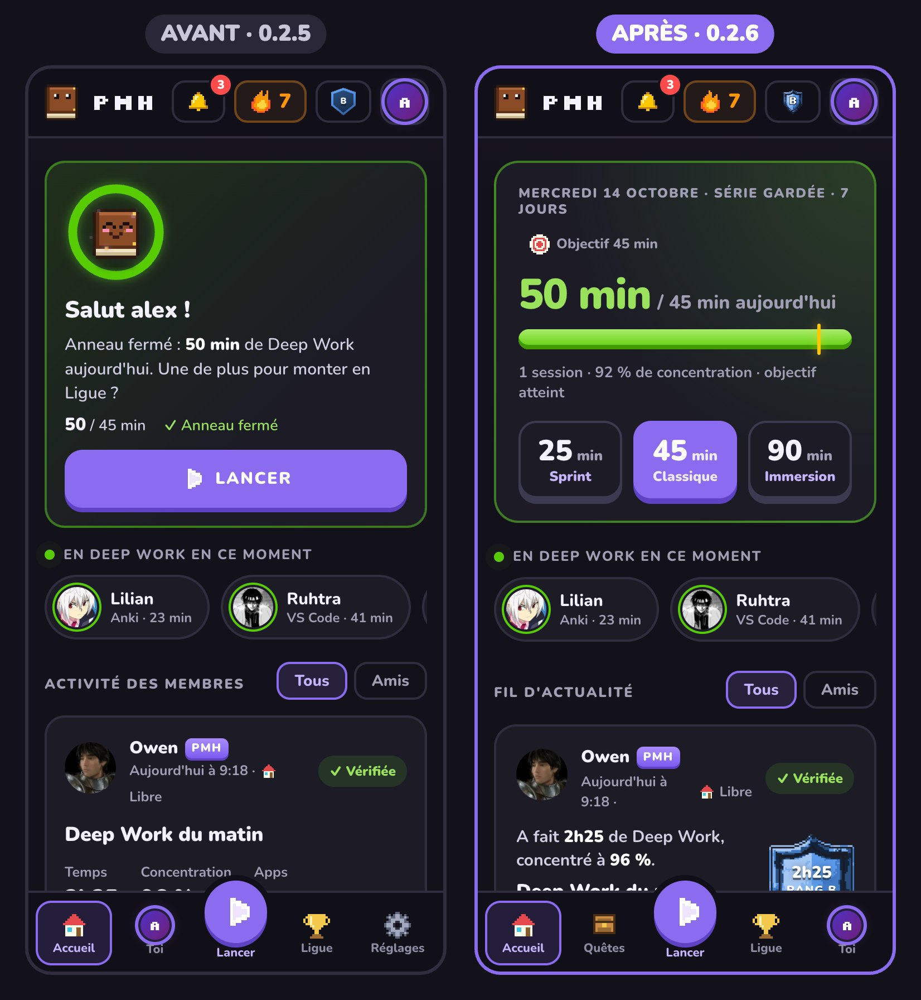
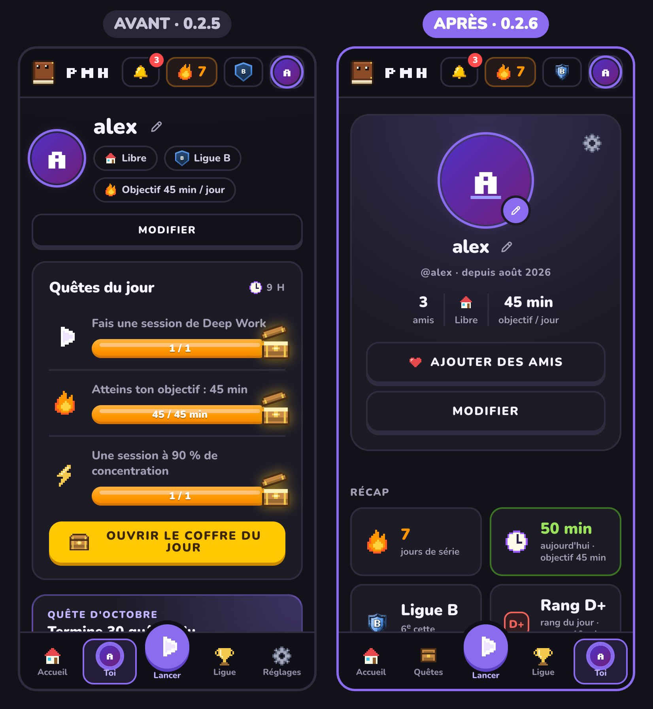
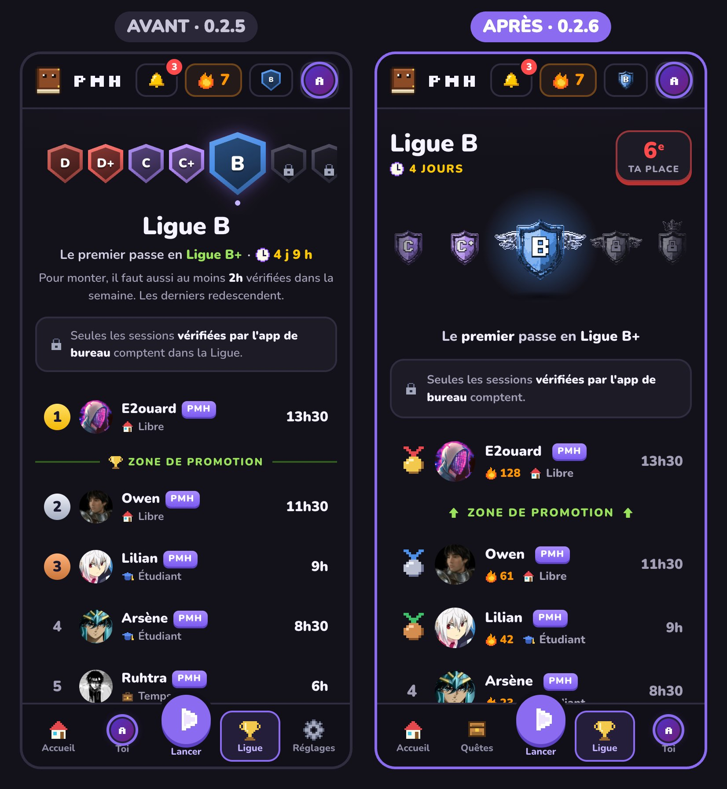
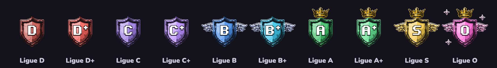
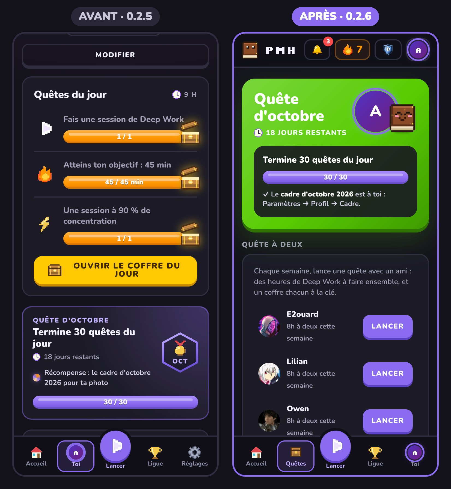
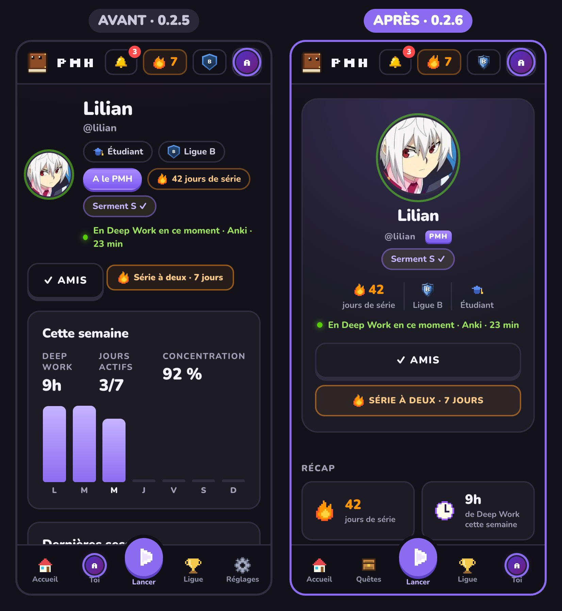

# PMH · versions de l'app

Les installeurs de l'app PMH, publiés automatiquement : **Mac, Windows, Linux** (app de bureau) et **Android** (téléphone).
Télécharge la dernière version dans [« Releases »](https://github.com/mx-motion/pmh-releases/releases/latest) : la page explique quel fichier prendre et comment l'installer. Sur ordinateur, l'app se met ensuite à jour toute seule ; sur Android, elle te propose les nouvelles versions.

## Nouveautés de la 0.2.7

### PMH sur Android
Une première version pour téléphone : connexion, Accueil, fil d'actualité, Quêtes, Ligue, profil et sessions. Sur téléphone, tes sessions comptent pour ta série et tes quêtes, mais pas pour la Ligue. L'app te propose elle-même les nouvelles versions.

### Et sur Linux
L'app de bureau arrive sur Linux (AppImage), avec les mises à jour automatiques, comme sur Mac et Windows.

## Nouveautés de la 0.2.6 : avant / après

### Accueil
Tes heures du jour en grand, une session en un clic (25, 45 ou 90 min), et un fil d'actualité où tu vois aussi les GG que tu as reçus.

### Ton profil
Refait comme celui de Duolingo : ton récap en tuiles, tes séries à deux, tes progrès, tes badges mensuels et tes records.

### La Ligue
De nouveaux écussons en pixel art, ta place toujours visible, et moins de places pour monter quand la ligue est haute.

### Les quêtes
Elles ont leur page : la quête du mois, la quête à deux avec un ami, les quêtes du jour avec un seul coffre, et les défis.

### Le profil des autres membres
Sur le même modèle que le tien : sa série, sa ligue, son récap, sa semaine et ses dernières sessions.

